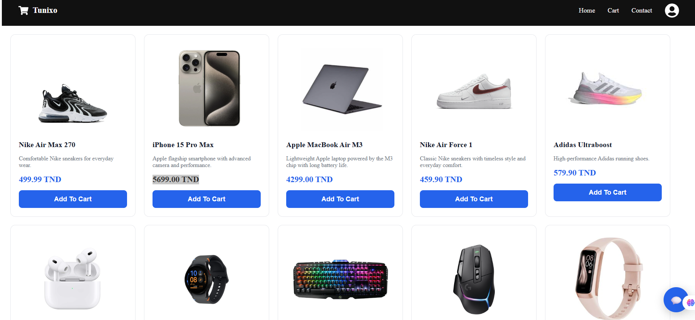

# Tunixo

Tunixo is a full-stack e-commerce demo with a product storefront, an administration dashboard, and an AI shopping assistant. The assistant uses an LLM to answer questions about products in the store catalog.

**Live website:** [https://e-commerce-gilt-nine-43.vercel.app/](https://e-commerce-gilt-nine-43.vercel.app/)

## Features

- Browse products and add them to a shopping cart.
- Submit an order through the checkout flow. The demo records order details but does not process online payments.
- Ask the AI shopping assistant questions about products. It uses the store catalog as its product context and is instructed not to invent product details.
- Manage products, orders, return requests, and customer contact messages in the admin dashboard.
- Create and update product listings, track order status, and review customer messages.

## Tech stack

**Frontend**
- React
- React Router
- Axios

**Backend**
- Node.js and Express
- MongoDB with Mongoose
- Groq API for LLM-powered chat

**Deployment**
- Vercel for the frontend
- Render for the backend

## Project structure

```text
.
├── backend/
│   ├── controllers/
│   ├── routes/
│   ├── db.js
│   ├── models.js
│   └── server.js
└── frontend/
    └── src/
        ├── components/
        └── pages/
```

## Run locally

### Requirements

- Node.js and npm
- A MongoDB connection string
- A Groq API key for the AI assistant

### 1. Configure the backend

```powershell
cd backend
npm install
```

Create `backend/.env`:

```env
PORT=5000
MONGODB_URI=your_mongodb_connection_string
GROQ_API_KEY=your_groq_api_key
CLIENT_URL=http://localhost:3000
```

Start the API:

```powershell
npm run dev
```

The backend runs at `http://localhost:5000`.

### 2. Configure and run the frontend

In another terminal:

```powershell
cd frontend
npm install
npm start
```

The frontend runs at `http://localhost:3000`. By default, it connects to the API at `http://localhost:5000`. To use a different backend URL, create `frontend/.env` and set:

```env
REACT_APP_API_URL=https://your-backend-url
```

Restart the frontend after changing environment variables.

## Deployment

### Backend on Render

1. Create a **Web Service** connected to this repository.
2. Set the **Root Directory** to `backend`.
3. Use `npm install` as the build command and `npm start` as the start command.
4. Configure these environment variables in Render:

   | Variable | Value |
   | --- | --- |
   | `MONGODB_URI` | Your MongoDB connection string |
   | `GROQ_API_KEY` | Your Groq API key |
   | `CLIENT_URL` | The deployed frontend origin, such as `https://your-site.vercel.app` |
   | `PORT` | Set automatically by Render |

### Frontend on Vercel

1. Import the repository into Vercel.
2. Set the **Root Directory** to `frontend`.
3. Add `REACT_APP_API_URL` with the base URL of your deployed backend, for example `https://your-service.onrender.com` (do not append `/api`).
4. Deploy or redeploy the frontend after setting the environment variable.

Make sure `CLIENT_URL` on Render matches the deployed Vercel site origin.

## Notes

- The AI assistant requires a valid `GROQ_API_KEY`. Keep this key in the backend environment only; do not put it in frontend variables or commit it to source control.
- The checkout flow stores order information and is intended as a project demo; it does not integrate a payment provider.
- Add production-grade authentication and authorization before using the admin features with real customer or business data.


